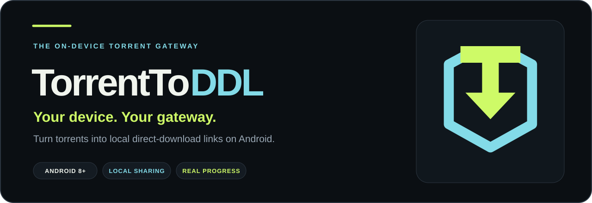
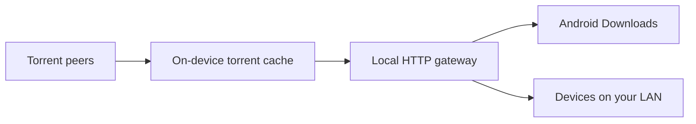

<p align="center">
  
</p>

<p align="center">
  <a href="https://github.com/Saakihegde12345/TorrentToDDL/releases/latest/download/TorrentToDDL.apk"></a>
</p>

<p align="center">
  <a href="https://github.com/Saakihegde12345/TorrentToDDL/releases/latest"><strong>Release notes &amp; checksums</strong></a>
  &nbsp; · &nbsp;
  <a href="#quick-start"><strong>Quick start</strong></a>
  &nbsp; · &nbsp;
  <a href="#under-the-hood"><strong>Build &amp; contribute</strong></a>
  &nbsp; · &nbsp;
  <a href="https://github.com/Saakihegde12345/TorrentToDDL/issues"><strong>Report an issue</strong></a>
</p>

<p align="center">
  <a href="https://github.com/Saakihegde12345/TorrentToDDL/actions/workflows/release.yml"></a>
  <a href="https://github.com/Saakihegde12345/TorrentToDDL/actions/workflows/build-apk.yml"></a>
</p>

---

## Meet your pocket gateway

**TorrentToDDL turns your Android device into a local torrent-to-HTTP gateway.**
Add a magnet link or a `.torrent` file, browse its files, save them to Downloads,
or open their direct links from another device on the same network.

Torrent metadata unlocks the file list. The entire torrent does **not** need to
finish before you request a file; the gateway waits for the required pieces.

<table>
<tr>
<td width="50%"><strong>01 · ADD YOUR TORRENT</strong><br><br>Resolve magnet links or choose a <code>.torrent</code> file from Android's file picker.</td>
<td width="50%"><strong>02 · SAVE TO YOUR DEVICE</strong><br><br>Send a file to Android Downloads and follow its received bytes, progress and status.</td>
</tr>
<tr>
<td width="50%"><strong>03 · SHARE ACROSS YOUR LAN</strong><br><br>Copy a direct HTTP link for another device on the same Wi-Fi or hotspot.</td>
<td width="50%"><strong>04 · SEE WHAT IS MOVING</strong><br><br>Separate torrent-cache and local-save meters show the two stages of a transfer.</td>
</tr>
<tr>
<td width="50%"><strong>05 · CONTROL THE GATEWAY</strong><br><br>Explicit Start and Stop controls, foreground protection, and background idle shutdown.</td>
<td width="50%"><strong>06 · MADE FOR ANDROID</strong><br><br>A graphite interface, lime and cyan accents, adaptive launcher icons and themed-icon support.</td>
</tr>
</table>

## Quick start

| Step | What to do |
| :--- | :--- |
| **1 · Install** | Download **[TorrentToDDL.apk](https://github.com/Saakihegde12345/TorrentToDDL/releases/latest/download/TorrentToDDL.apk)**. Android 8.0 or newer is required. |
| **2 · Start** | Open the app and press **Start Gateway**. Allow notifications to see gateway and transfer status in the notification drawer. |
| **3 · Add** | Paste a magnet link and select **Resolve magnet**, or use **Browse .torrent**. Wait for the file list. |
| **4 · Use** | Choose **Save to device**, **Open file**, or **Copy LAN link** on a file card. |

**For another device:** use the LAN link while both devices are on the same
network and the gateway is running. The `127.0.0.1` link works only on the Android
device hosting the gateway.

> [!NOTE]
> These are local/LAN links, not public internet-hosted download URLs.
> Anyone who can reach the gateway on your network may request an exposed file.
> Use LAN sharing on a trusted network.

## One transfer. Two stages.



| Meter | What it measures | How to read it |
| :--- | :--- | :--- |
| **Torrent cache · cyan** | Wanted payload bytes present versus total wanted bytes, plus peer receive rate and peer count. | May include data cached earlier. File-checking task percentages are not counted as downloaded payload. |
| **Saving to Downloads · lime** | Android DownloadManager's received bytes, total size, transfer state and measured byte rate. | Cached files can save much faster than your internet connection because this stage uses local loopback. |

Save speeds come from byte differences over elapsed monotonic time.
There is no simulated progress or artificial speed cap. Peer availability and
network conditions determine how quickly uncached torrent data arrives.

Allow storage space for **both the torrent cache and the copy saved to Downloads**.

## Your gateway, your controls

**The gateway stays on while the app is visible**, including when the torrent is
fully cached or a save finishes. Active background transfers keep it running.
An unused background gateway gets a fresh 30-second idle window.

Use **Home** to continue transfers in the background. **Back**, removal from
Recents, **Stop**, and **Reset** stop the gateway and end unfinished managed saves.

<details>
<summary><strong>Gateway lifetime, download timeouts &amp; notifications</strong></summary>

- The app opens with the gateway off. **Start Gateway** starts the foreground
  service and HTTP listener; **Stop Gateway** stops networking and cancels
  unfinished downloads started through this app. Opening an incoming torrent
  or magnet also starts the gateway.
- While the app is visible, the gateway stays on even if idle, fully cached,
  or all saves have finished. Stop and Reset still work immediately.
- After backgrounding, an unused gateway gets a fresh 30-second idle window.
  Metadata resolution gets up to three minutes. Queued downloads and active
  HTTP streams keep it alive.
- In-app downloads display Android DownloadManager's received bytes, percentage,
  waiting state and completion/failure reason. Errors also produce a toast.
  Results remain visible while the app is bound, after the gateway auto-stops.
- In the background, once all in-app transfers finish and HTTP streams close,
  the gateway stops. External HTTP clients get a 30-second gap between requests
  before idle-stop.
- A managed download with no byte progress for three minutes is cancelled with
  an error. Individual torrent stream waits are bounded at two minutes.
- Home keeps downloads running. Back, removal from Recents, Stop and Reset stop
  the gateway. Reset requires Start before another load. Native teardown runs
  off the Android main thread. The service does not restart itself after being killed.
- Allow notifications to see the gateway notification. If app or channel
  notifications are blocked, the app shows **Enable notifications**, which opens
  Android settings. Denial does not prevent Android from running a foreground
  service, but can hide its notification from the drawer.
- HTTP responses carry a stable torrent/file ETag and accept matching If-Match
  range requests so interrupted Android downloads can resume without mixing
  bytes from another torrent. Sparse swarms can still stall or fail; the app
  now displays the Android failure reason.
- Once cached, peer transfers and discovery pause until another explicit load.

The JVM tests exercise real HTTP download/resume, stale torrent rejection,
idle policy and native libtorrent handle recycling/reset. Android device testing
is still needed for notification settings, task behavior, actual torrents and
battery consumption. Active downloads use network, CPU and storage; no measured
battery-life improvement is claimed.

</details>

<details>
<summary><strong>Troubleshooting · common questions</strong></summary>

**The gateway notification is missing.**

Use **Enable notifications** in the app. Check both app notification permission
and the gateway notification channel in Android settings.

**A save jumps forward very quickly.**

Cached data can be copied locally to Downloads at storage/loopback speed.
Check which of the two progress meters you are reading.

**A download is queued, paused or fails.**

Read its in-app status and error toast. Check torrent peers, network access and
available storage. Android DownloadManager failure reasons are displayed in-app.

**A LAN link will not open.**

Keep the gateway running, use the LAN link rather than the loopback link, and
confirm both devices can communicate on the same network. Some networks isolate clients.

**Android reports conflicting packages during an update.**

An update needs the same application ID and signing certificate, plus a compatible
version code. Public releases keep `com.example.torrenttoddl` and the established
persistent identity. v1.0.6 uses version code 7.

Older temporary-key builds may require a one-time uninstall. Back up anything
needed first: uninstalling removes app data and the torrent cache. A higher
version number cannot fix a signing-certificate mismatch.

</details>

## Desktop workspace · Windows 1.1.0

The shared Kotlin engine now has a Compose Desktop workspace with a persistent
multi-torrent queue, transfer/file tables, download settings, bandwidth and
seeding controls, authenticated sharing, and a separate backend process.
Stop terminates that backend while the desktop stays open. Minimized transfers
continue, and close-to-tray is configurable. The build
targets **Windows x64**, **Intel/Apple Silicon macOS** and **Linux x64**; Android remains supported.

| Platform | Preview installer |
| :--- | :--- |
| Windows x64 | `TorrentToDDL-windows-x64.msi` or portable `.zip` |
| Intel macOS | `TorrentToDDL-macos-x64.dmg` |
| Apple Silicon macOS | `TorrentToDDL-macos-arm64.dmg` |
| Debian / Ubuntu x64 | `TorrentToDDL-linux-x64.deb` |

[Desktop build status](https://github.com/Saakihegde12345/TorrentToDDL/actions/workflows/build-desktop.yml)
· [Preview releases](https://github.com/Saakihegde12345/TorrentToDDL/releases)
· [Desktop setup, behavior and limitations](docs/desktop.md)

**Windows source quick start:** double-click `Start-Windows.cmd`. It prepares
local build tools on the first run, tests and builds the app, then opens it.
Portable releases include Java: extract the ZIP and open
`TorrentToDDL/TorrentToDDL.exe`.

An optional [headless server](docs/server.md) supports remote hosting with
separate administration and download keys. Public deployment requires your own
server and HTTPS setup.

The workflow publishes direct installer assets only after desktop native tests,
packaged-launcher checks and the Android regression build pass. Desktop installers
are experimental and unsigned; macOS is not notarized. iOS has a separate developer preview below;
browser clients are not included. Interactive desktop testing is still
required before a stable desktop release.

## iPhone & iPad · developer preview

A SwiftUI iOS/iPadOS 17+ app uses a native C++ torrent bridge, real cache/save
progress, Files import/export, LAN downloads and explicit gateway controls.
The gateway stops when the app is backgrounded. Android background behavior
remains unchanged.

[iOS build status](https://github.com/Saakihegde12345/TorrentToDDL/actions/workflows/build-ios.yml)
· [Apple Silicon and iOS setup](docs/apple-platforms.md)

The iOS workflow tests on an ARM64 simulator and builds an **unsigned device
archive**. Developer artifacts require Xcode; the device archive is not an
installable signed IPA. Device signing and TestFlight/App Store distribution
are separate steps. See the Apple guide for the exact limits and commands.

## Under the hood

| Layer | Implementation |
| :--- | :--- |
| **Interface** | Kotlin · Jetpack Compose · Material 3 |
| **Torrent engine** | libtorrent4j with native Android libraries |
| **Gateway** | NanoHTTPD · port `8080` · local/LAN HTTP |
| **File saves** | Android DownloadManager |
| **APK architectures** | `arm64-v8a` · `armeabi-v7a` · `x86_64` |
| **Platform** | Android 8.0+ · compile/target SDK 34 |

The HTTP layer supports normal downloads, open-ended and suffix byte ranges,
stable torrent/file ETags and matching `If-Match` resume requests. File lookup
uses torrent metadata and the app cache; the URL filename is display-only.

<details>
<summary><strong>Local development · toolchain &amp; commands</strong></summary>

The project requires JDK 17 and Android SDK 34. From the project root, use the
same checks as CI:

```text
gradle :app:lintDebug :app:check :core:test :app:assembleDebug --no-daemon
```

The app targets Android 34 and requires Android 8.0 (API 26) or newer. It uses
cleartext HTTP because the gateway is intentionally a local/LAN HTTP service.
Anyone who can reach the device on that network may request an exposed file;
use the gateway only on a trusted network.

</details>

<details>
<summary><strong>Development workflow · GitHub Actions</strong></summary>

The workflow in `.github/workflows/build-apk.yml` runs on pushes and pull
requests targeting `main` or `master`, and can also be started manually from
the **Actions** tab with **Build Android APK** → **Run workflow**.

The workflow:

- Uses Temurin JDK 17.
- Uses Gradle 8.5 through `gradle/actions/setup-gradle`.
- Runs `lintDebug` and `check`.
- Builds `assembleDebug`.
- Names the APK `TorrentToDDL.apk`.
- On successful push/manual builds, publishes it as a GitHub prerelease asset
  and adds a direct **Download TorrentToDDL.apk** link to the workflow summary.
- Uses Actions artifacts only for job transfer and pull-request previews;
  downloading an Actions artifact still produces a ZIP.
- Uploads Android build and test reports when available.

This repository intentionally uses the existing Gradle configuration and does
not include a generated wrapper. GitHub Actions provisions Gradle 8.5 directly
when `./gradlew` is absent; the workflow will automatically use a wrapper if
one is added later.

</details>

<details>
<summary><strong>Public releases · signed APKs &amp; verification</strong></summary>

Version tags such as `v1.0.6` trigger the Public Android Release workflow.
Release lint, JVM tests, signing identity and the non-debuggable flag are checked
before publishing a normal GitHub release marked Latest. Assets include
`TorrentToDDL.apk`, `SHA256SUMS`, the public certificate report and the SVG logo.
Missing signing secrets fail the release instead of generating a temporary key.
Existing debug development builds remain available through the original workflow.


Public tags must match Android `versionName`, reference a commit reachable from
`main`, and include `release-notes/<tag>.md`.

Public releases attach:

- **`TorrentToDDL.apk`** — the direct Android installer.
- **`SHA256SUMS`** — APK checksum.
- **`apk-signing-certificate.txt`** — public certificate information.
- **`torrenttoddl-logo.svg`** — editable vector brand mark.

Actions artifact downloads are ZIP files. Use the release APK asset for the
direct installer. Public APKs are checked to ensure they are not debuggable.

</details>

<details>
<summary><strong>Maintainers · preserve the signing identity</strong></summary>

The repository secret `DEBUG_KEYSTORE_BASE64` contains the original persistent
keystore. Its historical name is retained for compatibility; public releases use
the same identity through the `persistentRelease` signing configuration.

The restoration script exports `TORRENTTODDL_DEBUG_KEYSTORE` for Gradle.
The alias is `androiddebugkey`, with the standard Android debug store/key
passwords. Keep a private backup of the original keystore.

Do not commit the keystore, publish its Base64 value, or replace the signing
identity with a newly generated key. Public releases fail when the secret is
missing or the certificate does not match the established fingerprint.

Development builds without the secret use temporary keys. Pull-request builds
never receive the persistent secret and may not update public installations.

The public certificate report is safe to share. An APK or its certificate
cannot recover the private signing key.

</details>

## Help shape the next release

Try the app and **[report reproducible issues](https://github.com/Saakihegde12345/TorrentToDDL/issues)**.
Include your Android version, app version, reproduction steps and the visible
error message. Remove private filenames, magnet links and sensitive details
before sharing logs.

JVM tests cover HTTP download/resume, stale-torrent rejection,
foreground/background idle policy and native libtorrent handle recycling/reset.
Device-specific notification behavior, task lifecycle, swarm conditions and
battery consumption still need Android device testing.

---

<p align="center">
  <br>
  <strong>ON DEVICE. IN YOUR CONTROL.</strong><br>
  <sub>Made for Android · TorrentToDDL</sub>
</p>
